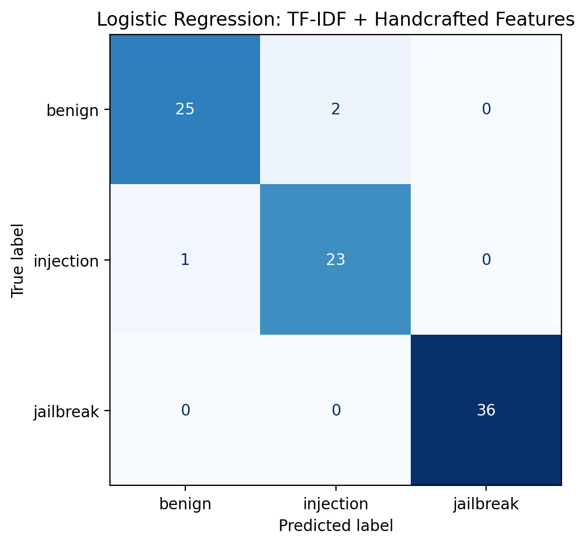

# Prompt Injection Detector

An educational machine-learning project exploring whether lightweight text
classifiers can distinguish benign prompts, prompt-injection examples, and
jailbreak-style requests.

Built in Google Colab using Python and scikit-learn.

## Project overview

This project compares classical machine-learning models using TF-IDF text
features and handcrafted structural features.

The experiments include:

- Dataset preparation and inspection
- A TF-IDF-only logistic-regression baseline
- Comparison of logistic regression, random forest, and linear SVM
- Five-fold stratified cross-validation
- Feature ablation
- Confusion-matrix and error analysis
- Feature-contribution analysis of a false positive
- A small qualitative challenge set

The goal is to understand both the capabilities and limitations of a small
prompt classifier, not to provide a production-ready security filter.

## Research question

Can TF-IDF and simple structural features distinguish the project's three
prompt labels, and how well do the resulting models handle newly written
examples?

## Dataset

The prepared dataset contains 435 prompts:

| Label | Number of prompts |
|---|---:|
| Benign | 133 |
| Injection | 119 |
| Jailbreak | 183 |
| Total | 435 |

### Sources and preparation

- Benign and injection examples were drawn from the training split of
  `deepset/prompt-injections` on Hugging Face.
- An English-word heuristic was applied during preparation. This is not
  reliable language identification and may retain or exclude examples
  incorrectly.
- Jailbreak-style examples were generated with AI assistance for this
  educational project.
- Missing text/label values and exact duplicate texts were removed during
  preparation.
- The resulting dataset was shuffled using a fixed random seed.

The prepared file is available at `data/prompts.csv`.

Original dataset:
https://huggingface.co/datasets/deepset/prompt-injections

The source dataset's licence and attribution requirements apply to its
examples. The repository's code licence does not replace those requirements.

### Label definitions

The labels are operational categories for this experiment:

- `benign`: legitimate requests without an intended instruction or safety
  bypass.
- `injection`: examples labelled as injection in the source dataset.
- `jailbreak`: synthetic examples intended to request unrestricted behaviour
  or bypass safety constraints.

These categories are not a universal or mutually exclusive security taxonomy.
Some instruction-override examples could reasonably fit both injection and
jailbreak categories.

## Features

### Text features

TF-IDF features use:

- Word unigrams and bigrams
- Minimum document frequency of 2
- Sublinear term-frequency scaling

### Handcrafted features

- Character count
- Word count
- Uppercase-letter ratio
- Special-character ratio
- Presence counts for selected instruction-override phrases
- Presence counts for selected role-play phrases
- Code-block marker presence
- A Base64-like character-pattern indicator

The Base64-like indicator is a heuristic, not a validator or evidence of an
attack.

## Evaluation setup

The dataset was divided into:

- Training portion: 348 prompts
- Test portion: 87 prompts

The split used `random_state=42` and stratification by label.

The initial model comparison used the test split and is therefore exploratory:
that split was not an untouched final evaluation after model selection.

Five-fold stratified cross-validation was subsequently performed on the
training portion. TF-IDF and scaling were fitted separately inside each fold
through a scikit-learn pipeline.

## Results

### Exploratory classifier comparison

All three models in this table use TF-IDF and handcrafted features.

| Model | Test accuracy | Test macro F1 | Benign false-positive rate |
|---|---:|---:|---:|
| Logistic regression | 0.9655 | 0.9607 | 0.0741 |
| Random forest | 0.9195 | 0.9072 | 0.0741 |
| Linear SVM | 0.9655 | 0.9607 | 0.0741 |

Logistic regression was retained as the main experimental model.

### Cross-validation and feature ablation

Values are the mean and standard deviation across five folds on the training
portion.

| Features | Mean accuracy | Mean macro F1 | Macro F1 standard deviation |
|---|---:|---:|---:|
| TF-IDF only | 0.9080 | 0.8940 | 0.0203 |
| TF-IDF + handcrafted | 0.9368 | 0.9270 | 0.0450 |

Handcrafted features improved average macro F1 but increased variation across
folds. These results do not establish statistical significance.

### Confusion matrix



The combined logistic-regression model correctly classified 84 of the 87
test prompts:

- Benign: 25 of 27
- Injection: 23 of 24
- Jailbreak: 36 of 36

The benign false-positive rate was 2/27, or 7.41%, on this split.

### Error analysis

The three test errors included:

- An injection-labelled persona request predicted as benign. Its adversarial
  intent was ambiguous without the original application context.
- Two ordinary advice requests predicted as injection.

A separate benign request about summarising a renewable-energy article was
predicted as jailbreak.

Feature-contribution analysis showed that structural features pushed this
prediction toward jailbreak. Only "about" and "this" were represented as active
TF-IDF features, illustrating limited vocabulary coverage.

### Qualitative challenge set

A small, AI-generated challenge set was created after model development.

| Expected label | Matched expected label | Total |
|---|---:|---:|
| Benign | 1 | 6 |
| Injection | 1 | 4 |
| Jailbreak | 5 | 5 |
| Total | 7 | 15 |

Five benign prompts were incorrectly labelled jailbreak, including legitimate
role-play, ordinary fiction, and discussion of security. Three injection
examples were also labelled jailbreak.

These results expose overprediction of the jailbreak class on the challenge
set. They show that strong within-dataset scores did not translate into
reliable classification of these newly written examples.

This small, deliberately constructed set is a qualitative diagnostic, not an
independent benchmark or an estimate of real-world performance.

## Main takeaway

The combined features improved average within-dataset performance, but the
model remained sensitive to vocabulary coverage, structural cues, and dataset
construction.

The experiment demonstrates why strong scores on a small, partly synthetic
dataset are insufficient evidence of a reliable security detector.

## Limitations

- Small dataset
- AI-generated jailbreak examples with repeated wording and templates
- Different sources for different classes, creating possible source/style bias
- Exact deduplication does not remove near-duplicate templates
- Overlap and ambiguity between injection and jailbreak labels
- Heuristic English filtering
- No application system instructions or conversation history
- Vocabulary limitations for unfamiliar prompts
- Exploratory model selection using the existing test split
- No independently collected external evaluation
- No adaptive-attacker or multi-turn evaluation
- No formal latency, memory, or deployment-efficiency benchmark

## Repository structure

```text
prompt-injection-detector/
├── data/
│   └── prompts.csv
├── results/
│   ├── classification_report.csv
│   ├── confusion_matrix.png
│   ├── cross_validation.csv
│   ├── environment.csv
│   ├── feature_comparison.csv
│   ├── misclassified_prompts.csv
│   ├── model_comparison.csv
│   ├── qualitative_challenge_results.csv
│   ├── qualitative_challenge_summary.csv
│   └── test_predictions.csv
├── build_dataset.ipynb
├── prompt_injection_detector.ipynb
├── requirements.txt
├── README.md
├── LICENSE
└── .gitignore
```

## How to run

### Google Colab

1. Open `prompt_injection_detector.ipynb` in Google Colab.
2. Ensure the dataset-loading cell points to this repository's
   `data/prompts.csv`.
3. Connect to a standard CPU runtime.
4. Run cells from top to bottom.
5. Supply a prompt when the interactive cell requests input.

The notebook includes an initial TF-IDF-only baseline and a later combined
pipeline. For the combined model, use:

```python
predict_prompt_combined("Explain photosynthesis in simple terms.")
```

Predictions may be incorrect. Do not interpret a returned label as a security
guarantee.

### Dependencies

```bash
pip install -r requirements.txt
```

The analysis notebook loads the prepared CSV. The dataset-building notebook
documents its preparation and is not required to rerun the analysis.

Package versions from the recorded experiment are listed in
`results/environment.csv`.

## Future work

- Define and audit a clearer labelling policy.
- Add diverse benign examples, including legitimate role-play and security
  discussion.
- Use independent data sources across all classes.
- Evaluate with source-aware or template-grouped splits.
- Compare against a binary benign-versus-attack formulation.
- Test a character-level text baseline.
- Measure inference latency and resource use before making efficiency claims.

## Responsible use

This is an educational classification experiment, not a production guardrail.
It should not be used as the sole protection for an LLM application.

Synthetic examples describe high-level bypass attempts rather than operational
harmful procedures. Public-source examples retain their original dataset
provenance.

## AI assistance

AI assistance was used to generate synthetic examples and support code,
analysis, and documentation drafting.

## Resources and acknowledgements

### Dataset

- [deepset/prompt-injections on Hugging Face](https://huggingface.co/datasets/deepset/prompt-injections)
  : Source of the benign and injection-labelled examples used in this project.
  The dataset card provides information about the original data and its licence.

The jailbreak-style examples and qualitative challenge prompts were generated
with AI assistance for this project. They were not taken from an independently
collected jailbreak benchmark.

### Security background

- [OWASP: LLM01 — Prompt Injection](https://genai.owasp.org/llmrisk/llm01-prompt-injection/)
  : Background on prompt injection, jailbreaks, and the limitations of defences.

- [OWASP: LLM Prompt Injection Prevention Cheat Sheet](https://cheatsheetseries.owasp.org/cheatsheets/LLM_Prompt_Injection_Prevention_Cheat_Sheet.html)
  : Guidance on prompt-injection risks and layered mitigations.
  This educational classifier is not a substitute for those protections.

### Implementation and evaluation

- [scikit-learn: TF-IDF vectorization](https://scikit-learn.org/stable/modules/generated/sklearn.feature_extraction.text.TfidfVectorizer.html)
  : Documentation for the text representation used in the experiments.

- [scikit-learn: Pipelines](https://scikit-learn.org/stable/modules/generated/sklearn.pipeline.Pipeline.html)
  : Documentation for combining preprocessing and classification.

- [scikit-learn: Cross-validation](https://scikit-learn.org/stable/modules/cross_validation.html)
  : Guidance on evaluating models across multiple data splits.

- [scikit-learn: Common pitfalls and recommended practices](https://scikit-learn.org/stable/common_pitfalls.html)
  : Guidance on preprocessing leakage and keeping model evaluation separate
  from model development.

### Software citation

Pedregosa, F., et al. (2011).
[Scikit-learn: Machine Learning in Python](https://jmlr.org/papers/v12/pedregosa11a.html).
Journal of Machine Learning Research, 12, 2825–2830.
